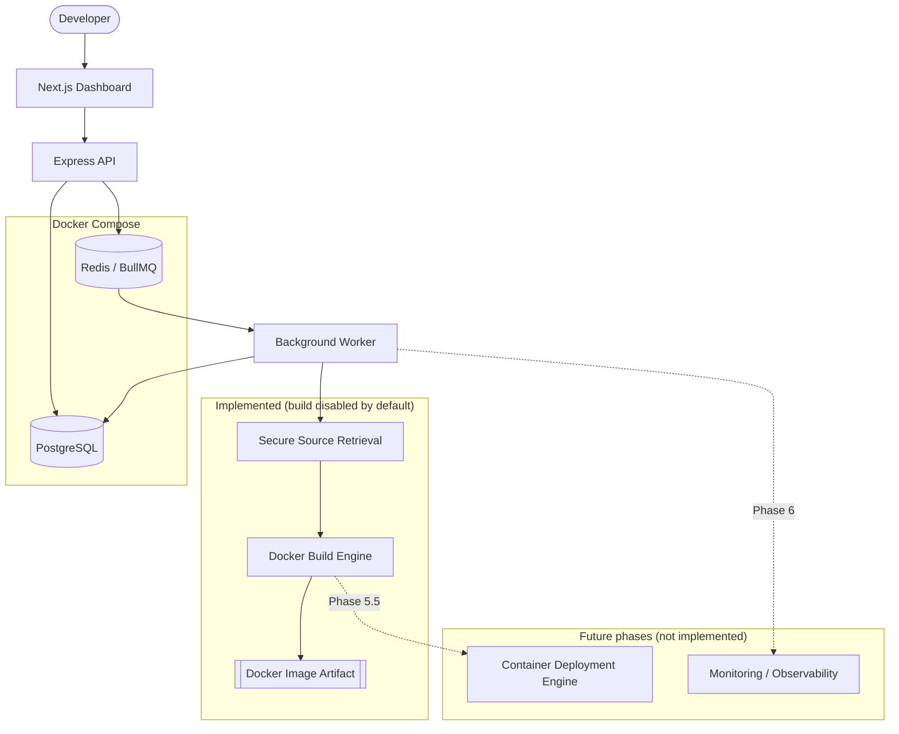
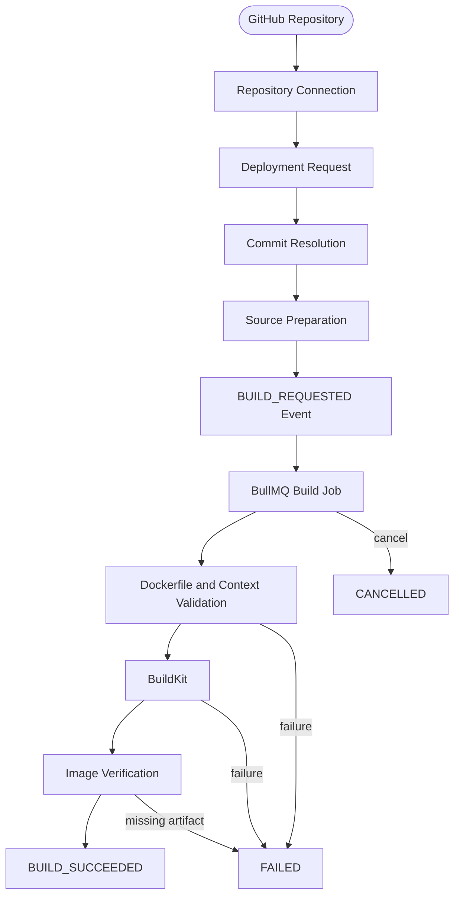

# CloudPilot — DevOps Automation Platform

**An evolving platform for GitHub-integrated deployment automation, secure source retrieval, Docker image builds, and cloud infrastructure management.**

[](https://nextjs.org/)
[](https://react.dev/)
[](https://www.typescriptlang.org/)
[](https://tailwindcss.com/)
[](https://nodejs.org/)
[](https://expressjs.com/)
[](https://www.postgresql.org/)
[](https://www.prisma.io/)
[](https://redis.io/)
[](https://docs.bullmq.io/)
[](https://www.docker.com/)
[](LICENSE)

CloudPilot is a monorepo platform for building secure, observable, and recoverable DevOps
automation. It combines a Next.js control-plane dashboard, an Express API, PostgreSQL data
layer, Redis-backed job infrastructure, and a background worker to automate the path from a
GitHub repository to a verified container image.

> **Status:** CloudPilot is under active development. Implemented code, enabled features, and
> verified behavior are **not** interchangeable — see [Current Development Status](#3-current-development-status)
> and [Configuration and Security](#10-configuration-and-security) for the precise boundaries.

---

## Table of Contents

1. [Overview](#2-overview)
2. [Current Development Status](#3-current-development-status)
3. [Implemented Features](#4-implemented-features)
4. [System Architecture](#5-system-architecture)
5. [Deployment Pipeline](#6-deployment-pipeline)
6. [Tech Stack](#7-tech-stack)
7. [Monorepo Structure](#8-monorepo-structure)
8. [Getting Started](#9-getting-started)
9. [Configuration and Security](#10-configuration-and-security)
10. [Tests and Verification](#11-tests-and-verification)
11. [Roadmap](#12-roadmap)
12. [Contributing](#13-contributing)
13. [Author](#14-author)

---

## 2. Overview

CloudPilot aims to simplify deployment infrastructure and automate the DevOps lifecycle:
connect a GitHub repository, resolve an immutable commit, retrieve source securely, build a
Docker image, and (in future phases) deploy, monitor, and roll back the running application.

The project is organized as an **npm workspaces monorepo** with a strict separation of concerns:

- **Frontend** (`apps/web`) — Next.js dashboard and operational UI.
- **API** (`apps/api`) — Express control plane, authentication, authorization, and orchestration.
- **Worker** (`apps/worker`) — BullMQ background processing for source retrieval and builds.
- **Database** (`packages/database`) — shared Prisma schema, client, and migrations.
- **Queue** (`packages/queue`) — shared queue contracts and Redis utilities.

PostgreSQL is the **authoritative state store**. Redis provides asynchronous job delivery and
coordination only — Redis job state never replaces authoritative deployment state in PostgreSQL.

**Vision vs. today:** The long-term vision includes container deployment, real-time logs,
health checks, automatic rollback, webhooks, monitoring, and cloud provisioning. **Today**, the
platform implements the deployment foundation, orchestration, secure source retrieval, and a
Docker build engine that is **present in code but disabled by default**. Container execution,
monitoring, and cloud integration are **not** implemented.

---

## 3. Current Development Status

| Phase | Feature | Status |
|---|---|---|
| 5.1 | Deployment Foundation | Implemented |
| 5.2 | Deployment Orchestration | Implemented |
| 5.3 | Secure GitHub Source Retrieval | Implemented |
| 5.4 | Docker Build Engine | Implemented, disabled by default |
| 5.5 | Container Deployment Engine | Planned |
| 5.6 | Real-time Deployment Logs | Planned |
| 5.7 | Health Checks and Rollback | Planned |
| 5.8 | GitHub Webhooks and Auto Deployment | Planned |
| 5.9 | End-to-End Deployment Validation | Pending |
| 6 | Prometheus and Grafana Monitoring | Planned |
| 7 | AWS and Terraform Integration | Planned |
| 8 | AI-Powered DevOps Assistant | Planned |
| 9 | Production Hardening | Planned |

> **Implementation status does not imply production readiness.** Phase 5.4 is implemented but
> disabled by default and has **not** been verified end-to-end through the worker pipeline.

See [`docs/phase-5-architecture.md`](docs/phase-5-architecture.md) for the authoritative
milestone and security notes.

---

## 4. Implemented Features

The following capabilities are confirmed by the source code. Items marked *(disabled by default)*
are implemented but not enabled in a default local setup.

**Platform & data**
- Workspace and project management with workspace-scoped, multi-tenant data models.
- GitHub App integration and repository importing, with branch and repository metadata.
- PostgreSQL 15 + Prisma 7 persistence with applied, additive migrations.
- Environment-variable storage design with versioned ciphertext (encryption design; key rotation not yet operational).

**Orchestration**
- Deployment queue and orchestration backed by Redis and BullMQ.
- Transactional outbox coordinating database acceptance with asynchronous queue publication.
- Deployment status management via an authoritative conditional state machine.
- Execution leases (fencing tokens) and worker heartbeat with capability reporting.
- Cooperative cancellation and bounded retries with failure classification.

**Secure source retrieval (Phase 5.3)**
- Immutable commit resolution (branches resolve to a fixed commit SHA).
- GitHub App installation revalidation and short-lived installation tokens.
- SHA-pinned archive download with streaming size limits and restricted redirects.
- Hardened TAR.GZ extraction with path-traversal and entry-type validation.
- Isolated per-attempt source workspaces with cleanup and capacity checks.

**Docker build engine (Phase 5.4, *disabled by default*)**
- Dockerfile structure validation (requires a `FROM` instruction; named-stage target checks).
- Build context validation with size/count bounds and symlink/special-file rejection.
- Build security policy checks (rejects privileged entitlements, host networking, SSH/secret/host-bind mounts, remote `ADD`, custom frontends).
- Docker BuildKit integration via `docker buildx` using argument arrays (`shell: false`).
- Docker image tagging and artifact verification before success publication.
- Build metadata and bounded, sanitized build-log persistence.
- Backend build status and build-log APIs.
- Frontend deployment and build status display.

> Source preparation success does **not** imply deployment success. The build stage exists in
> code but is gated behind `BUILD_ENABLED=false` and strong-isolation requirements.

---

## 5. System Architecture



The build stage (`Docker Build Engine → Docker Image Artifact`) is present in code but
**disabled by default**. The Container Deployment Engine and Monitoring are shown separately as
future phases and are **not** implemented.

---

## 6. Deployment Pipeline



Failure and cancellation outcomes are shown where supported. The `SOURCE_PREPARED` transition
and build scheduling share one database transaction, so there is no database-to-queue gap.

> **Not yet verified end-to-end.** Enabling build execution requires additional security checks
> and a trusted, isolated builder. See [Configuration and Security](#10-configuration-and-security).

---

## 7. Tech Stack

| Area | Technology |
|---|---|
| Frontend | Next.js 16.4.6, React 19.3.0, TypeScript 5, Tailwind CSS 4.3.3 |
| UI | shadcn/ui (Radix UI), Lucide icons |
| Backend | Node.js (≥22), Express 5.3, Zod 4, Pino 10 |
| Database | PostgreSQL 15, Prisma 7.10.1 |
| Queues | Redis 7, BullMQ 6.7.9, ioredis 6.1.0 |
| Build Infrastructure | Docker, Docker BuildKit (`docker buildx`) |
| Integrations | GitHub App (Octokit), GitHub OAuth |
| Development | npm Workspaces, TypeScript, Docker Compose |

> AWS, Terraform, Kubernetes, Prometheus, Grafana, and AI are **roadmap items** and are not
> integrated in the current codebase.

---

## 8. Monorepo Structure

```text
CloudPilot/
├── apps/
│   ├── web/          Next.js dashboard (App Router, React 19, Tailwind 4)
│   ├── api/          Express control plane (auth, orchestration, REST API)
│   └── worker/       BullMQ worker (source retrieval, build engine)
├── packages/
│   ├── database/     Shared Prisma schema, client, and migrations
│   ├── queue/        Shared queue contracts and Redis utilities
│   ├── shared/       Reserved shared package (currently empty)
│   └── config/       Reserved shared configuration package (currently empty)
├── docs/             Architecture, security, and phase documentation
├── docker-compose.yml
└── package.json      npm workspaces root
```

- **`apps/web`** — Next.js dashboard and operational UI (deployments, projects, environment variables, logs, monitoring, settings).
- **`apps/api`** — Express API with Helmet, CORS, Pino, rate limiting, request IDs, and centralized errors.
- **`apps/worker`** — Background worker for secure source retrieval, build orchestration, and diagnostics.
- **`packages/database`** — Prisma schema, generated client, and migrations (authoritative schema).
- **`packages/queue`** — Typed queue contracts and Redis/BullMQ utilities shared by API and worker.
- **`packages/shared` / `packages/config`** — Reserved for future shared code and configuration; currently empty.
- **`docs/`** — Architecture and operational documentation, including per-phase notes.

---

## 9. Getting Started

### Prerequisites

- Node.js **22+** and npm **10+**
- Docker Engine and Docker Compose
- A local copy of the repository

### Setup (Windows PowerShell)

```powershell
# 1. Clone the repository
git clone https://github.com/raziquehasan/CloudPilot.git
cd CloudPilot

# 2. Install dependencies
npm install

# 3. Configure environment
Copy-Item .env.example .env
# Edit .env and set local development values (never commit the real .env)

# 4. Start PostgreSQL and Redis
docker compose up -d postgres redis

# 5. Generate the Prisma client and validate migration status
npm run db:generate
npm run db:status

# 6. Build shared packages and apps (database -> queue -> worker -> api -> web)
npm run build
```

### Run the services

```powershell
# Terminal 1 — API
npm run dev -w @cloudpilot/api

# Terminal 2 — Worker
npm run dev -w @cloudpilot/worker

# Terminal 3 — Web dashboard
npm run dev -w web
```

### Access

- Dashboard: <http://localhost:3000>
- API: <http://localhost:8000> (v1 under `/api/v1`)

### Common database and infrastructure commands

```powershell
npm run db:format      # Format the Prisma schema
npm run db:validate    # Validate the schema
npm run db:migrate     # Create/apply a development migration
npm run db:status      # Show migration status
npm run db:studio      # Open Prisma Studio

npm run infra:up       # Start all Compose services
npm run infra:status   # Show Compose service status
npm run infra:down     # Stop Compose services
```

> PostgreSQL is published only on `127.0.0.1:5433` and Redis only on `127.0.0.1:6379`, both
> backed by named volumes (`cloudpilot_postgres_data`, `cloudpilot_redis_data`).

---

## 10. Configuration and Security

CloudPilot is **security-first** and fails closed when authorization or readiness is uncertain.
Important limitations to understand before running:

- **`BUILD_ENABLED=false` by default.** The Docker build engine is implemented but not enabled.
- **Untrusted repository builds must remain disabled** without strong isolation.
- **The local Docker driver is not a secure multi-tenant sandbox.** It does not enforce per-build network or resource policies; the builder reports `supportsStrongIsolation=false`.
- **Build engine implementation does not imply production readiness.** Phase 5.4 has not been verified end-to-end through the worker pipeline.
- **Container deployment is not implemented yet** (Phase 5.5). No application container is started.
- **Worker-orchestrated end-to-end build verification remains pending.** Real BuildKit execution was verified with a controlled fixture, not a full READY-source worker run.
- **Workspace storage readiness needs verification** for distributed/remote builders; local filesystem storage does not automatically support them.
- **The existing Prisma/Effect dependency advisory is unresolved** (`GHSA-7589-6fvf-x4pw`). Do not run forced `npm audit fix` or introduce unverified overrides. See [`docs/security.md`](docs/security.md).
- **Never commit `.env`, private keys, tokens, or secrets.** Queue payloads must contain identifiers and non-sensitive metadata only.

Additional security references:

- [`docs/security.md`](docs/security.md) — security model and dependency advisory.
- [`docs/phase-5-architecture.md`](docs/phase-5-architecture.md) — trust boundaries and isolation requirements.
- [`docs/phase-5.4-docker-build-engine.md`](docs/phase-5.4-docker-build-engine.md) — build isolation model and limitations.

---

## 11. Tests and Verification

Historical **Phase 5.4** validation results (reported at the time of implementation):

- **Worker tests:** 33 / 33 passed.
- **API default tests:** 4 / 4 passed.

These are **historical Phase 5.4 results**, not a continuous guarantee. They do **not** represent
comprehensive end-to-end testing. The full worker-orchestrated build pipeline with a READY source
workspace remains outstanding verification.

---

## 12. Roadmap

- **Container deployment** — authorized image execution, container lifecycle, runtime isolation (Phase 5.5).
- **Deployment logs and health checks** — ordered build/runtime logs, bounded retention, secret redaction, health checks (Phases 5.6–5.7).
- **Automatic rollback** — stop/restart/redeploy and rollback with resource cleanup (Phase 5.7).
- **Webhook-driven deployments** — signature verification, delivery idempotency, explicit auto-deploy config (Phase 5.8).
- **Monitoring and observability** — Prometheus and Grafana metrics and dashboards (Phase 6).
- **AWS and Terraform** — cloud infrastructure provisioning (Phase 7).
- **Kubernetes** — container orchestration at scale.
- **AI-assisted operations** — AI-powered log analysis and a DevOps assistant (Phase 8).
- **Production security and reliability** — hardening, isolation verification, and release gates (Phase 9).

---

## 13. Contributing

Contributions are welcome. To keep the platform secure and reviewable:

1. Fork the repository and create a feature branch.
2. Make focused, additive changes; avoid rewriting applied migrations.
3. Run type checks, tests, and builds for the workspaces you touch.
4. Update relevant `docs/` when behavior or architecture changes.
5. Open a pull request describing the change and its verification.

Please do not commit secrets, credentials, or `.env` files.

Repository: <https://github.com/raziquehasan/CloudPilot>

---

## 14. Author

**Razique Hasan**

- GitHub: <https://github.com/raziquehasan>
- Repository: <https://github.com/raziquehasan/CloudPilot>

## License

CloudPilot is licensed under the MIT License. See the [LICENSE](LICENSE) file for details.